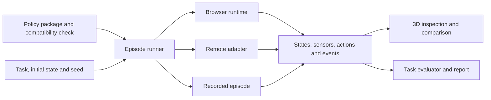

# Centoria: browser policy preview and evaluation ecosystem

Research date: 2026-11-21, America/Los_Angeles. Local project inspected at
`a24f7c23d8cf0b1a518918e1692b06d300f11dd7`.

## Recommendation

Develop Centoria into a place to **publish a robot policy, try it interactively,
and inspect a reproducible evaluation**. Keep the existing React, Three.js,
MuJoCo WASM and ONNX worker as the first supported runtime. Make policy packages,
task definitions and episode evidence reusable before adding more robot types.

This is a product direction, not an established novelty claim. Browser robotics
already has close alternatives: mjswan for exporting interactive demos, RunRobot
for policy packaging and sharing, and ManiLoop for evaluation across benchmarks.
The useful hypothesis to test is whether researchers want a particularly simple
path from a verified policy export to an embeddable demo and an inspectable
comparison. The likely contribution is the integration and evaluation experience.

Evidence below has three strengths: **source-inspected** means code was read;
**documented** means the maintainers describe the feature; **measured locally**
means this checkout was executed. External systems were not installed or
benchmarked against one another. A browser UI is not evidence that physics,
inference, or evaluation runs in that browser.

## 1. What this project already provides

The code is substantially beyond a kinematic robot viewer:

| Existing part | Evidence in this checkout | Implication |
| --- | --- | --- |
| Real closed-loop controller | `src/lite_pro_policy.js`: depth rays, image processing, observation history, inference, PD and motor envelope | The integration unit must include more than an ONNX file. |
| Independent simulation worker | `src/simulation.worker.js`: MuJoCo and ONNX WASM, one inference thread, transferred poses with backpressure | Preserve the responsive frontend and explicit stepping semantics. |
| Fixed control timing | `contract.json`: 5 ms physics, decimation 4; 2,798 inputs and 34 actions | Expose timing and embodiment as package requirements. |
| Headless execution | `src/simulation.js`, `scripts/verify_simulation.js` | Reuse this path for an evaluation runner. |
| Controller conformance check | `scripts/verify_policy_parity.js` | Make reference traces part of policy onboarding. |
| Recorded explainer | `src/motion_viewer.js`, `scripts/record_explainer.js` | A replay mode already has a local starting point. |
| Asset provenance | `contract.json`, `THIRD_PARTY.md`, catalog export metadata | Extend provenance from assets to complete runs. |

The main constraints are visible in code: `Simulation` constructs `LiteProPolicy`
directly; the worker hardcodes the Lite Pro asset root; validation assumes Lite
Pro joint layout; navigation, building geometry and fall detection are tied to
the apartment. These are sensible choices for the current app, but are the
boundaries to extract for a platform.

`PROPOSAL.md` promises a challenge/results/history experience and a Hugging Face
policy explorer. I did not find an assignment rubric in the tracked project
files. The current main page and README do not establish delivery of those
promised results/history and policy-explorer flows. Treat these as proposal
gaps to check, not a claim about the course grading requirements.

The catalog is a source of environments, not yet a task generator: exporting a
furniture selection does not insert it into physics, create valid spawn points,
or define a task's success condition. Likewise, the character view changes
presentation; it does not create a new robot embodiment or policy evaluation.

## 2. What the three supplied websites actually demonstrate

### SuperMimic: an interactive computational explanation

The current [project page](https://supermimic.github.io/) links to a
[standalone demo](https://supermimic.github.io/demo/). The inspected
[worker](https://supermimic.github.io/demo/worker.mjs) loads a custom
`engine.wasm`, configuration and weights for the world-model path. It lazily
loads MuJoCo when the simulation comparison is enabled. The
[frontend](https://supermimic.github.io/demo/main.js) provides reference motion,
policy enable/disable, friction, action noise and body dragging.

This particular build is not simply ONNX Runtime plus MuJoCo: its custom WASM
engine is central. JS source establishes the architecture, but does not expose
all numerical internals of that binary. The page's benchmark concerns coverage
of training motions; it explicitly distinguishes that from generalization.

**Design lesson:** expose the scientific question through controls and paired
views. Keep learned predictions, reference trajectories and rigid-body results
visually distinct. A viewer should say which computation produced each robot.

### MicroDuck: browser gameplay and constrained community policies

At Space revision `efedf47f4d4ae52d17ad2e108a5b8795d41537a3`,
[game.js](https://huggingface.co/spaces/pollen-robotics/microduck-simulator/blob/efedf47f4d4ae52d17ad2e108a5b8795d41537a3/app/src/game/game.js)
loads MuJoCo WASM and ONNX Runtime Web, uses the WASM execution provider, and
sets one inference thread. Docker-based Space hosting does not imply remote
policy inference.

Its
[community-policy loader](https://huggingface.co/spaces/pollen-robotics/microduck-simulator/blob/efedf47f4d4ae52d17ad2e108a5b8795d41537a3/app/src/game/custom-policy.js)
already accepts Hub references and direct ONNX URLs. It checks declared robot,
input/action dimensions and policy kinds, and smoke-tests inference. This is
more than a single bundled walking demo. Compatibility remains bounded by the
MicroDuck interface, and some absent manifest fields assume defaults.

**Design lesson:** offer a curated, compatible set with immediate controls.
For evaluation, require complete contracts, pin revisions, and go beyond smoke
tests; equal tensor dimensions do not establish equal observation semantics.

### HALO: a recorded run with rich inspection

The [website](https://apple-aiml-research.github.io/ml-halo/) contains a WebGL
viewer, camera controls, plans, ego/depth images and synchronized logs. The HTML
source labels the run canvas as replaying a recorded real-robot run, lazily loads
`assets/runs/<id>/run.js`, and applies recorded motion. It also contains a
kinematic driver and a comment describing a possible future MuJoCo policy
driver. Do not infer deployed live inference from the label “Simulation Results.”

The [paper](https://arxiv.org/abs/2611.06908) describes the autonomy system;
the website's replay mechanism and that system are different artifacts.

**Design lesson:** recorded runs are useful first-class outputs. Synchronized
plans, sensor views and events can explain a failure much better than a video.
Clearly label replay, procedural motion, live physics and live inference.

## 3. Closest systems to assess before building more infrastructure

| System | Execution and scope | Relevance and evidence limit |
| --- | --- | --- |
| [mjswan](https://github.com/ttktjmt/mjswan) | Browser MuJoCo, ONNX and Three.js; Python authoring/export tooling | Closest reusable demo runtime. Source/docs inspected at `28373d0a2bebde00f8fb47fabf508b18aac51344`; integration not executed. |
| [RunRobot](https://github.com/runrobotics/runrobot) | Policy/robot/scene manifests, validators and browser/simulation runtime tooling; separate hosted product | Direct overlap with publishing and sharing. README and [hosted documentation](https://runrobot.sh/docs) describe the workflow; operational coverage was not tested. |
| [ManiLoop](https://github.com/Daniel-rmc/ManiLoop) | Local Python application with a browser workspace and CLI; adapters for MuJoCo tasks, LIBERO, robosuite and RoboCasa | Direct overlap with evaluation and episode inspection. Its project website separately replays recorded episodes. README inspected; adapters not executed. |
| [SO-101 Policy Lab](https://github.com/noah-wardlow/so101-policy-lab) | Browser MuJoCo and ACT ONNX inference; optional remote MolmoAct2 endpoint | Useful manipulation and local/remote inference reference. Maintainer-documented, not independently benchmarked. |
| [zero2robot](https://github.com/kaushikb11/zero2robot) | Robotics course with a browser policy playground | Adjacent educational product. The author's [runtime description](https://github.com/microsoft/onnxruntime/discussions/29685) names MuJoCo WASM and ONNX Runtime Web. |

### mjswan deserves a focused compatibility experiment

Its [mjlab guide](https://mjswan.readthedocs.io/en/latest/guides/mjlab/) and
[pinned source](https://github.com/ttktjmt/mjswan/blob/28373d0a2bebde00f8fb47fabf508b18aac51344/docs/docs/guides/mjlab.md)
describe exporting observations, actions, commands, terminations and events.
This addresses much of the error-prone environment porting around a network.

There are material boundaries at this revision: RGB comes from Three.js rather
than the training ray tracer; depth and segmentation camera outputs are not
rendered; rewards, curricula, metrics and recorders are omitted. Centoria's
trained depth preprocessing and task evaluator would therefore still need
explicit treatment. These are revision-specific limitations.

The [engine API](https://mjswan.readthedocs.io/en/latest/api/engine/) supports
embedding in an existing application, scene/policy selection and term seeds.
Its UI-free engine still renders into an element; do not equate that API with
Centoria's already demonstrated Node-only evaluation path. Inspect step control
and browser dependencies before using it as the evaluation engine.

**Recommendation:** try one simple supported mjlab export beside the current
Lite Pro adapter. Measure conformance and integration effort before deciding to
replace code. Treat mjswan and RunRobot formats as interoperability candidates;
avoid declaring another universal policy standard before testing those paths.

## 4. The ecosystem is a set of layers

### Visualization, replay and remote inspection

| Tool | What it supplies | How Centoria should relate to it |
| --- | --- | --- |
| [Viser](https://viser.studio/main/) | Python scene/GUI API with a browser client and WebSocket communication | Useful author-side debugger and remote adapter; not itself a policy or physics engine. |
| [Viser static exports](https://viser.studio/main/embedded_visualizations/) | Serialized static/dynamic scenes embeddable without a live Python process | Good publishing/replay reference. Exported scene messages do not execute new Python policy decisions. Docs mark the workflow experimental. |
| [MeshCat](https://github.com/meshcat-dev/meshcat) | Remotely controlled Three.js scene graph | Prior art for driving browser geometry from robotics code; supplying a controller remains separate. |
| [Rerun web embedding](https://rerun.io/docs/howto/integrations/embed-web) | Embeddable inspection of recorded/streamed robotics data | Consider an export or inspection integration rather than rebuilding every telemetry tool. |
| [Foxglove](https://docs.foxglove.dev/docs/visualization) | Data sources, playback, comparison, layouts and debugging panels | Relevant to ROS/MCAP workflows and timestamped evidence, not a substitute for simulation. |
| [Gazebo web visualization](https://gazebosim.org/docs/latest/web_visualization/) | Browser interaction with a running Gazebo simulation through a WebSocket server | Example of a remote simulation adapter rather than an all-client runtime. |

Viser versus MuJoCo is therefore not an either/or decision. One manages visual
interaction; the other computes dynamics. mjlab already offers both native and
[Viser viewers](https://github.com/mujocolab/mjlab/blob/main/docs/source/viewers.rst)
over its simulation loop. Centoria can publish static runs while authors keep
using Viser during training.

### Physics, inference, assets and training

| Tool | Role | Implication |
| --- | --- | --- |
| [MuJoCo Live / Studio WebViewer](https://mujoco.readthedocs.io/en/stable/studio/web_viewers.html) | Live runs simulator/rendering in the client; WebViewer runs Python simulation remotely and renders in the client | Official tools already cover generic model viewing and remote inspection. A custom product needs to add policy/task/evidence workflows. |
| [zalo/mujoco_wasm](https://github.com/zalo/mujoco_wasm) | Earlier browser MuJoCo simulation/rendering implementation | Historical related implementation; prefer evaluating the official binding already in this app. |
| [ONNX Runtime Web](https://onnxruntime.ai/docs/tutorials/web/build-web-app.html) | Browser inference, with explicit input preprocessing/output handling | Keep WASM as the validated default. Test an optional [WebGPU provider](https://onnxruntime.ai/docs/tutorials/web/ep-webgpu.html) per model; do not assume a universal speedup. |
| [MuJoCo Menagerie](https://github.com/google-deepmind/mujoco_menagerie) | Curated simulation models | Model availability does not imply a compatible trained policy. Retain model-specific licenses. |
| [mjlab](https://github.com/mujocolab/mjlab) | Manager-based robot-learning framework using MuJoCo Warp | Attractive export source, not the same execution target as browser WASM. |
| [MuJoCo Playground](https://github.com/google-deepmind/mujoco_playground) | Simulation/training/deployment workflows | Another source of tasks and checkpoints. Current README includes Studio web inspection; assess the actual revision rather than assuming older architecture. |
| [Newton](https://github.com/newton-physics/newton) and [Genesis](https://github.com/Genesis-Embodied-AI/genesis-world) | Broader simulation and robot-learning engines | Potential remote compute backends. The cited repositories do not establish drop-in compatibility with this JavaScript worker. |

For larger models, [openpi remote inference](https://github.com/Physical-Intelligence/openpi/blob/main/docs/remote_inference.md)
returns action chunks over a client/server interface. LeRobot's
[async inference](https://huggingface.co/docs/lerobot/main/en/async) documents
overlapping action queues. These are relevant protocols and timing semantics,
not browser drop-ins. An adapter must reproduce camera processing, action units,
chunk consumption, state reset and the supported embodiment.

### Evaluation methodology and task suites

| Related work | What to learn | Boundary |
| --- | --- | --- |
| [LIBERO](https://github.com/Lifelong-Robot-Learning/LIBERO) | Task suites, language, initial states and evaluation conventions | Import original evaluators and controllers if claiming LIBERO scores. An approximate browser scene is a new experiment. |
| [ManiSkill task cards](https://maniskill.readthedocs.io/en/latest/tasks/) and [evaluation setup](https://maniskill.readthedocs.io/en/latest/user_guide/learning_from_demos/setup.html) | Explicit observations, task success, randomization and episode handling | Study its distinction between success metrics and termination; do not pool mismatched protocols. |
| [SIMPLER](https://simpler-env.github.io/) | Studies simulation as a proxy for real-policy performance, including control and visual gaps | Its reported correlation applies to the studied setups, not arbitrary scenes or robot policies. |
| [Robo Use](https://robouse.ai/docs/) | Simulator-owned scoring, budgets and trial artifacts, including agent/VLA evaluation | Useful evaluator separation; it uses an episode server and is not a browser-only policy runtime. |

The research question is not answered by making an appealing demo. Evaluation
requires a declared task distribution and protocol. Simulated results do not
independently establish real-world capability.

## 5. A practical product architecture

Use a common episode model with explicitly different execution modes:

| Mode | Computation | Visitor experience |
| --- | --- | --- |
| Recorded | Saved states, sensors and events | Fast scrubbing and inspection, including models that cannot run locally. |
| Browser live | Compatible physics, preprocessing and policy inside the client | Steering, perturbations and small seeded evaluations without an inference service. |
| Remote live | Remote policy, or remote simulation and policy | Larger models and native environments, with visible connection and timing state. |

These modes can share a frontend and artifact format without claiming identical
compute placement. A browser-sim/remote-policy hybrid is a useful intermediate
case. Label it separately from remote simulation. Learned-world-model rollouts
also need a distinct dynamics label.



For this app, extract only four initial boundaries: policy adapter, task/reset
definition, explicit episode stepper, and observation/episode recorder. Keep
React and drawing outside the control loop. Keep navigation as an identifiable
controller whose version is part of a run. A route-following score measures the
planner, follower and locomotion stack together unless the experiment isolates
them.

### Package the executable contract

A usable package should identify:

- Immutable source revisions and hashes for weights, model, meshes and adapter.
- Robot/joint/actuator order, action type, offsets, scales, limits and PD gains.
- Physics settings, simulation/control/sensor rates and modeled latency.
- Observation units, coordinate frames, normalization, history and sensor pipeline.
- Policy state and reset rules, including recurrent state, delays and random state.
- Required commands/reference motions and compatible tasks/embodiments.
- Licenses for each artifact, source attribution and expected download sizes.
- Reference input/output traces and the runtime/provider they were validated on.

`public/assets/lite_pro/contract.json` is a start, but some of those semantics
currently live in JavaScript and generated constants. The package must bind
those pieces together. “Load model from Hugging Face” should initially mean
discover metadata, check compatibility, then enable Run for verified packages.
The [Hub API](https://huggingface.co/docs/hub/en/api) supplies discovery, not a
universal executable robot interface.

For the current export, `docs/POLICY.md` and `contract.json` identify the
policy/controller as CC BY-NC 4.0 and the robot description/meshes as MIT.
Keep those artifact-specific terms in the package; an engine's license does
not describe the weights or scene assets loaded into it.

### Make evaluation a fixed-step protocol

Define each task with a version, supported robot, scene/collision hashes,
explicit initial state or reproducible reset recipe, command schedule,
randomization distribution, time budget and success/failure functions.
Seeds alone are insufficient if scene construction or RNG consumption changes.

Run physics on simulation steps. Keep simulated completion time distinct from
wall-clock time. In the current worker, the wall-time accumulator is capped;
this is appropriate for interaction but does not make a slow device an equal
real-time deployment. Record real-time factor, preprocessing/inference latency,
deadline misses and provider separately from task outcomes.

For remote inference, declare whether physics waits for each decision or
continues under an action queue/latency model. Those protocols answer different
questions and must not share an unlabeled ranking.

Start with success rate and uncertainty, falls, forbidden obstacle contacts,
tracking error, task time, path length, and terminal reason. Distinguish success,
failure, timeout, cancellation and runtime error. Do not turn a distance/time
display into an overall policy-quality score. Mechanical actuator work, if
later added, needs its own definition and is not electrical energy.

Compare compatible policies on the same task cases. Preserve the full initial
state, controller histories and random state when needed; restoring `qpos`
alone is not an exact continuation. Keep evaluator-only state out of policy
inputs. Public browser results can be saved as exploratory runs; an official
leaderboard needs controlled execution and artifact verification.

## 6. Research-site presentation worth copying

Build one reusable viewer with a compact embed mode and a full inspection mode.
The compact entry point should load on demand and present a useful result before
asking visitors to understand robotics configuration.

Good interactions from the references include reference/executed overlays,
camera presets, visible reset, pause and timestep controls, controlled pushes,
sensor feeds and selectable failure examples. For comparisons, synchronize
simulation time and expose success definitions and reset conditions next to
the result. Share links should preserve package revision, task case, seed and
perturbation schedule; freeform human interaction should be recorded as events.

Preserve the current application's typography and controls. The platform can
have distinct Browse, Try, Compare and Inspect activities without needing a
new visual identity. A model card should show embodiment, observation type,
runtime mode, compatibility, provenance and a clear route into the demo.

The IKEA collection is potentially useful for obstacle and household-task
variations. Begin with curated placements and validated colliders. Arbitrary
catalog combinations need geometry checks, reset validity and task semantics
before they become benchmark cases.

## 7. Sequence the work with concrete decision gates

1. **Finish the class-facing loop.** Deliver one reliable challenge, results,
   local history and the promised Hub metadata explorer. Keep the present
   playground as the featured policy. Check the actual rubric before calling
   the assignment complete.
2. **Make a second policy integration the architecture test.** Use a compatible
   second checkpoint to test package swapping, then a different robot or task
   to reveal hidden embodiment assumptions. Validate against reference traces.
3. **Add a small evaluation suite.** Start with fixed command tracking, turn and
   stop, doorway clearance and calibrated perturbations. Keep stairs a
   separately reported exploratory condition. Produce replayable results and
   comparisons before building a leaderboard.
4. **Test mjswan interoperability.** Export one supported task, inspect the
   generated contract, compare observations/actions and physical trajectories,
   and record unsupported sensors or reset behavior. Test worker and headless
   requirements before a runtime migration.
5. **Test publishing with researchers.** Have several authors package and embed
   a policy. Measure manual adapter code, time to first verified run, failure
   diagnosis and reproducibility. Compare effort against mjswan and RunRobot.
6. **Add remote adapters when required by a real policy.** Begin with one
   documented inference protocol. Then consider native benchmark backends,
   retaining original controllers/evaluators and explicit timing semantics.

The first useful platform release could contain one robot, two compatible
policies, a few versioned tasks, paired comparison, saved episodes and an embed.
That is sufficient to test the product hypothesis without claiming arbitrary
policy support.

## 8. Local evidence and remaining experiments

Executed in this checkout:

- `npm test`: 22/22 passed.
- `node scripts/verify_policy_parity.js`: maximum absolute error zero for depth,
  processed images, observations, actions and poses over 24 noisy control steps.
- A new research probe ran three fresh 100-control-step rollouts, two with seed
  1 and one with seed 2, using the complete apartment without the route planner.
  Same-seed pose/action differences were zero. Changed-seed maximum absolute
  differences were about `0.01634` in the mixed-unit `qpos` vector and `0.16028`
  in normalized policy actions. Do not interpret the mixed-unit maximum as a
  distance error. All three short runs remained upright.

Reproduce the probe from the repository root:

```bash
node docs/research/2026-11-21/repro_probe.mjs
```

The script prints JSON. The saved [result](research/2026-11-21/repro_probe.json)
records runtime versions and trajectory hashes. This supports same-runtime
repeatability over two simulated seconds, not cross-browser determinism,
arbitrary-task success or real-world transfer. The full simulation regression
and a new public deployment were not run for this research-only change.

The next cheap falsification experiments are: replay identical cases on Chrome
and Firefox; compare WASM and any proposed WebGPU provider; run a declared seed
set on the target tasks; test recorded action/state replay; and attempt one
unmodified mjswan export. Define numerical tolerances and acceptable changes in
task outcomes before evaluating them. For longer evaluations, retain failures
and report the denominator rather than selecting successful episodes.

External source revisions, URLs and hashes for inspected mutable web builds
are in [sources.json](research/2026-11-21/sources.json). Hashes identify the bytes
read; they are not a promise that a live website will keep serving them.
